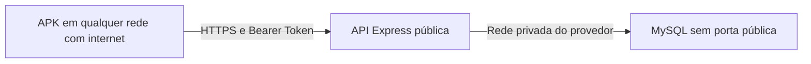

# API pública HTTPS — opções e plano de publicação

Revisão: 11/11/2026. **Plano somente: nenhuma API, banco, túnel ou recurso pago foi publicado/criado.** O celular está em rede diferente; o IP privado `172.20.134.251` foi retirado dos perfis de build e não será usado no APK definitivo.

## Recomendação

Para uma apresentação que funcione sem depender do computador ligado, recomendo **API Express e uma cópia do MySQL no mesmo projeto Railway**, com API pública HTTPS e banco na rede privada. A plataforma oferece MySQL e variáveis de conexão entre serviços; o banco não precisa de TCP Proxy público. [Documentação MySQL Railway](https://docs.railway.com/databases/mysql).

Isso é uma recomendação de implantação, não uma confirmação de disponibilidade ou desempenho de um serviço ainda não contratado. O banco local continua preservado; hospedar só a API e deixá-la tentando acessar `localhost` ou o IPv4 privado do seu computador não resolve a comunicação entre redes.

## Opções comparadas

| Opção | Vantagens para o Alimenta+ | Custos e responsabilidades | Adequação |
| --- | --- | --- | --- |
| Railway: Express + MySQL no mesmo projeto | Uma plataforma, domínio público para API, MySQL privado e volume persistente. Sem abrir 3306 no roteador. | Hobby tem uso mínimo de US$5/mês com US$5 em créditos de uso; consumo excedente é cobrado. API + banco/volume podem ultrapassar esse valor. Configurar orçamento, backups e verificar versão do MySQL. | Minha recomendação para manter a demonstração disponível sem o PC. |
| Render: Web Service Node + MySQL como Private Service com disco | HTTPS gerenciado no endereço da API e banco acessível apenas aos serviços do workspace. | API, serviço MySQL e disco são recursos separados; verificar preços atuais no painel. MySQL é auto-hospedado nesse desenho: exige backup lógico, atualização e monitoramento. Não contar com disco efêmero para o banco. | Alternativa se preferir o Render; não é um MySQL gerenciado automaticamente só por criar um Web Service. |
| Cloudflare Tunnel para a API local | Pode disponibilizar somente a porta HTTP da API por HTTPS; MySQL continua local e não precisa ser exposto. | Depende do computador, internet, API, MySQL e túnel ligados. Quick Tunnel é temporário e seu endereço para ao encerrar o processo; não é adequado para fixar URL de APK definitivo. Um túnel nomeado/domínio estável exige configuração adicional. | Possível demonstração temporária, menos confiável para a entrega final. Não foi iniciado. |

Fontes: [preços Railway](https://railway.com/pricing), [rede pública Railway](https://docs.railway.com/networking/public-networking), [MySQL privado no Render](https://render.com/docs/deploy-mysql), [TLS Render](https://render.com/docs/tls), [Quick Tunnels](https://developers.cloudflare.com/tunnel/get-started/quick-tunnels/). Preços em dólares, sem conversão, e sujeitos a mudança; verificar antes de autorizar cobrança. Não foi prometida hospedagem gratuita permanente.

Um VPS também é possível, porém exige administrar Linux, firewall, certificado, processo Node, MySQL e backups. Para este trabalho, plataformas com rede privada e HTTPS gerenciados reduzem o trabalho de infraestrutura.

## Plano concreto — Railway (somente após autorização)

1. **Escolher conta, plano e limite de gasto.** Autorizar explicitamente a publicação da API e a criação de uma cópia do banco. Publicar código no GitHub também continua dependendo de sua autorização; o remoto atual ainda está no primeiro commit.
2. **Preservar a origem.** Fazer backup lógico consistente do banco local. O script de estrutura instala tabelas vazias; ele não transfere registros. Se optar por migrar dados existentes, validar uma restauração em banco separado antes de usá-la. Os três valores antigos de unidade continuam pendentes de confirmação e não devem ser convertidos por suposição. Para demonstração, uma base nova com contas próprias pode evitar transportar dados pessoais, mediante escolha do usuário.
3. **Criar MySQL privado com volume persistente**, verificando versão compatível (projeto testado com MySQL 8.0.46, requisitos 8.0.16+). Não habilitar Public Access/TCP Proxy. Importar `database/estrutura_final_alimenta_plus.sql` no novo banco com uma sessão administrativa privada. Se o provedor usar outro nome de schema, definir conscientemente `alimenta_plus` e as permissões ou adaptar o script da cópia; nunca sobrescrever o banco local.
4. **Criar usuário exclusivo da API**, com permissões mínimas no schema (SELECT/INSERT/UPDATE para as operações atuais; exclusão é lógica). Usar conta administrativa somente para instalação e backup. Não usar credenciais do banco local nem gravar novas senhas no repositório.
5. **Criar serviço Node com o repositório na raiz.** Runtime Node 24; instalação `npm ci --omit=dev`; início **`node backend/server.js`**. Não usar `npm start`, pois inicia Expo. O backend já usa `PORT` do ambiente e escuta `0.0.0.0`.
6. **Configurar variáveis privadas no serviço da API**: `DB_HOST` = hostname privado do MySQL; `DB_PORT` = porta privada; `DB_NAME` = schema da cópia; `DB_USER`/`DB_PASSWORD` = credenciais do usuário exclusivo; `JWT_SECRET` = segredo aleatório próprio da hospedagem. Não copiar nada para `EXPO_PUBLIC_*`. As variáveis de serviço têm precedência sobre `backend/.env`; o arquivo local não deve ser enviado.
7. **Publicar apenas a API por HTTPS**, usando o domínio estável do provedor. Caminho esperado: `https://DOMINIO-REAL/api`. Configurar healthcheck `/api/health` e reinício do processo. Esse health é de disponibilidade da API; CRUD real deve validar a conexão com o banco.
8. **Revisar proxy/rate limit para o provedor escolhido.** `express-rate-limit` depende do IP do cliente. Por padrão não há proxy confiável; defina `TRUST_PROXY_HOPS` como o número de proxies confiáveis somente após confirmar a topologia e impedir acesso direto que permita falsificar o IP. Teste cadastro/login e limitação de tentativas no ambiente hospedado.
9. **Testar externamente antes do APK**: health no celular em dados móveis; cadastro dos dois papéis; login; publicação, edição, exclusão lógica; pedido, aprovação, endereço, recusa, cancelamento e entrega. Testar persistência após reinício e restauração de backup. Confirmar que 3306 não tem acesso público.
10. **Aprovar a URL final e o build.** Somente após as verificações acima configurar `EXPO_PUBLIC_API_URL` do ambiente EAS preview e gerar o APK. `.env` local do Expo Web permanece localhost. Procedimento: [APK_ANDROID.md](APK_ANDROID.md).

## Conexão segura ao MySQL

HTTPS protege celular → API; ele não configura automaticamente API → MySQL. Preferir rede privada entre serviços no mesmo projeto. Se escolher banco acessado por rede pública, configurar TLS no mysql2 com validação do certificado/CA exigida pelo provedor e restringir origens; nunca usar `rejectUnauthorized: false`. A conexão atual não inclui configuração SSL de provedor externo, portanto essa adaptação precisa ser feita e testada depois da escolha, antes de qualquer acesso público ao banco.

Para importar/administrar dados, usar shell privado, recurso seguro do provedor ou túnel administrativo autenticado. Não abrir 3306 para `0.0.0.0/0`, não fazer port forwarding do MySQL residencial e não subir `.env`/dump de dados pessoais ao GitHub. Backups precisam de acesso restrito e teste de restauração; snapshot de disco isoladamente não substitui backup lógico do MySQL.

## O que falta decidir

- Provedor/plano e orçamento aceitos.
- Base nova de demonstração ou cópia autorizada dos registros existentes.
- Conta para hospedagem e autorização de publicação; nenhuma senha deve ser enviada na conversa.
- URL HTTPS estável acessível no celular; ajuste de proxy/TLS conforme o provedor.
- Conta/projeto EAS e autorização para iniciar o build após o teste externo.

Enquanto isso, o aplicativo e o MySQL locais continuam funcionando. Nenhuma implantação, exposição de banco ou mudança de credencial local foi executada.
